# Rain Root

## Bill of Materials

| Item | Image | Description | Project Usage | Quantity | Product Link |
| ------ | ------- | ------------- | --------------- | ---------- | -------------- |
| Arduino Mega | 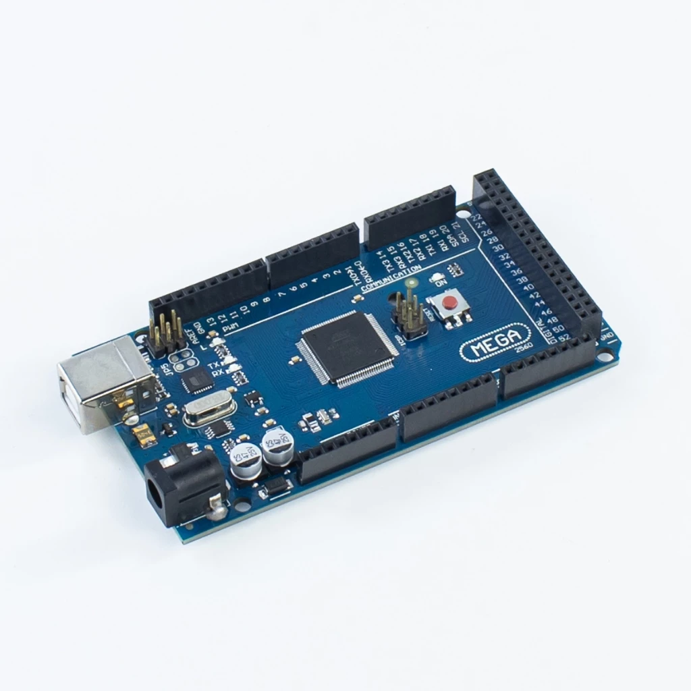 | Microcontroller board with many analog and digital I/O pins. | Main controller of the system. Reads the soil moisture sensors and switches the pumps through the relay module when moisture falls below the threshold. | 1 | |
| Protoboard 20x30cm | 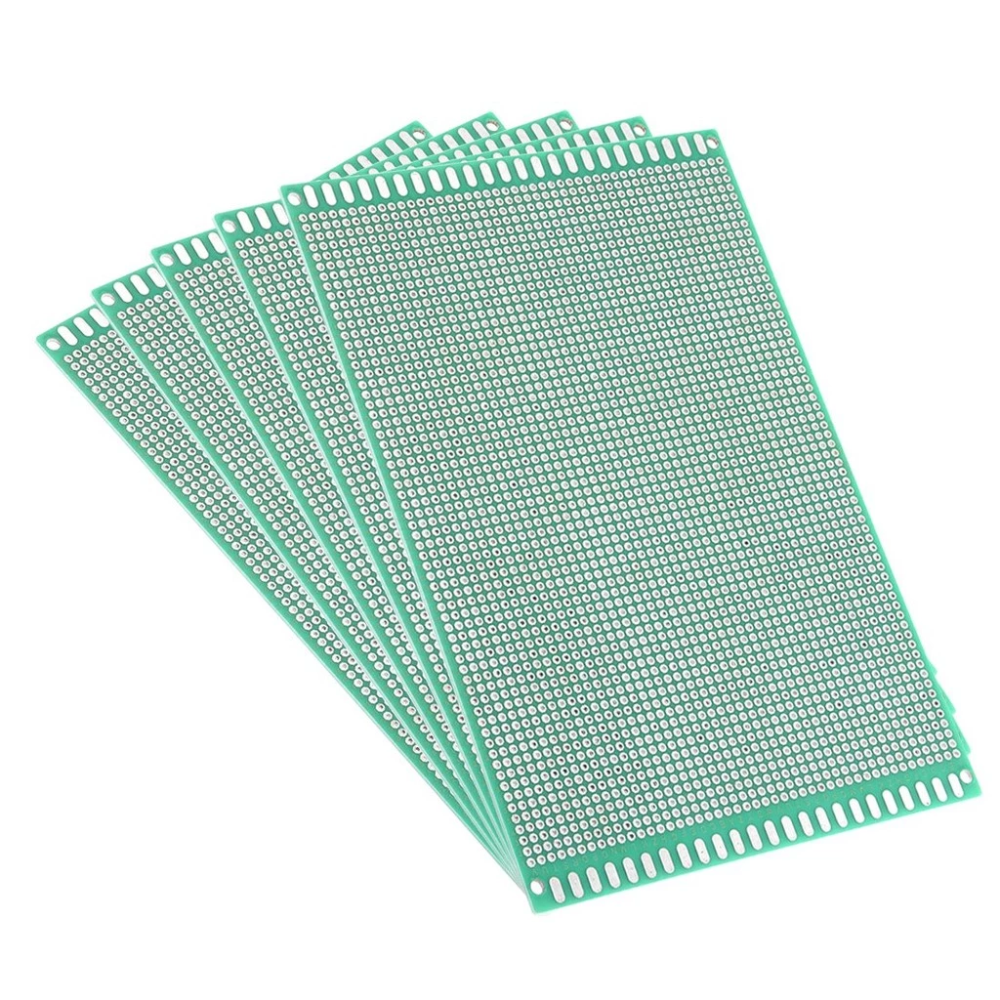 | Large perforated prototyping board for soldered circuits. | Base for the permanent circuit: mounts the pinheaders and connects the Arduino, sensor lines, relay module, and power distribution. | 1 | |
| Male Pinheaders | 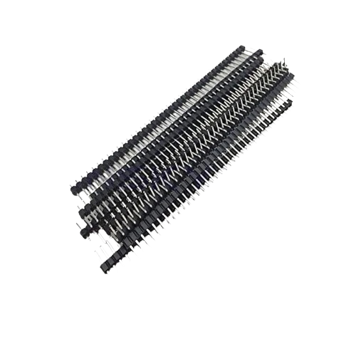 | Single-row male connector strips. | Soldered on the protoboard to provide plug-in connection points for the Arduino and sensor/relay wiring. | 10 | |
| Female Pinheaders |  | Single-row female socket strips. | Soldered on the protoboard as sockets so the Arduino and modules can be plugged in and removed without soldering. | 10 | |
| Analog Capacitive Soil Moisture Sensor | 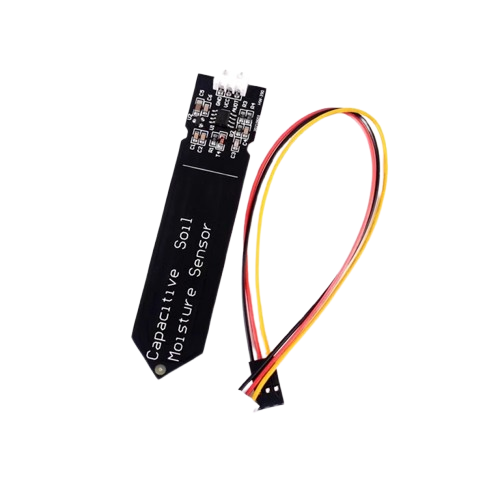 | Corrosion-resistant sensor that outputs an analog voltage proportional to soil moisture. | One sensor per pot, wired to the Arduino analog inputs to measure each plant's soil moisture. | 4 | |
| 16 Channel Relay Module |  | Board of 16 relays that switch high-current loads from low-power logic signals. | Controlled by the Arduino to turn each peristaltic pump on and off; spare channels are available for expansion. | 1 | |
| LiPo Battery 18650 | 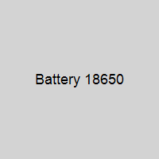 | Rechargeable 18650 cells for energy storage. | Battery bank (9 cells) that stores solar energy and powers the Arduino, relay module, and pumps, including when there is no sunlight. | 9 | |
| Solar Panel 100W | 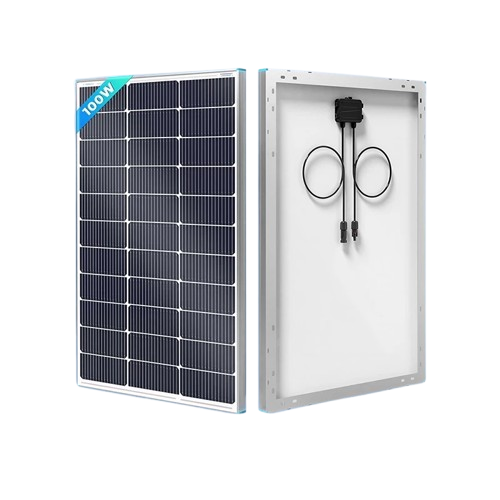 | Photovoltaic panel that converts sunlight into electricity. | Primary power source; charges the battery bank through the charge controller. | 1 | |
| PWM Solar Charge Controller | 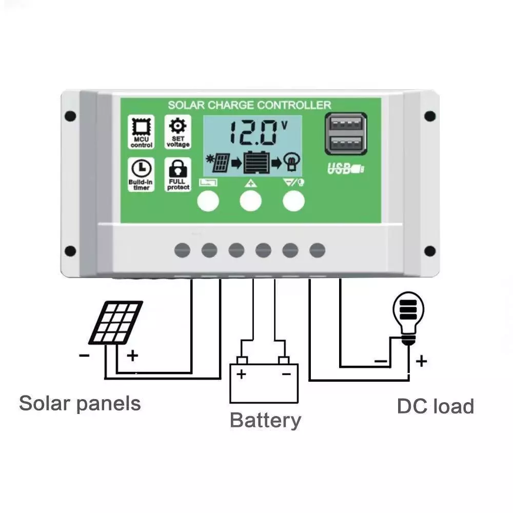 | Regulates solar panel output to charge a battery safely using PWM. | Placed between the solar panel and battery bank to prevent overcharging and protect the batteries. | 1 | |
| XL4015 Buck Converter | 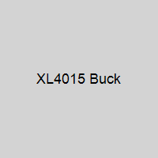 | Adjustable DC-DC step-down converter (up to 5A). | Steps the battery voltage down to the regulated voltage required by the Arduino, relay module, and pumps. | 1 | |
| Peristaltic Pump | 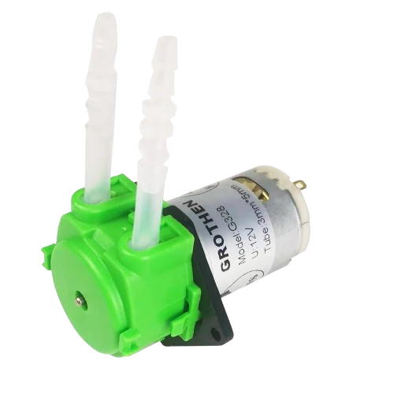 | Pump that moves liquid by compressing a flexible tube; self-priming and accurate. | One pump per pot, switched by the relay module to deliver measured water from the tank to the plant. | 4 | |
| Silicone Tubing | 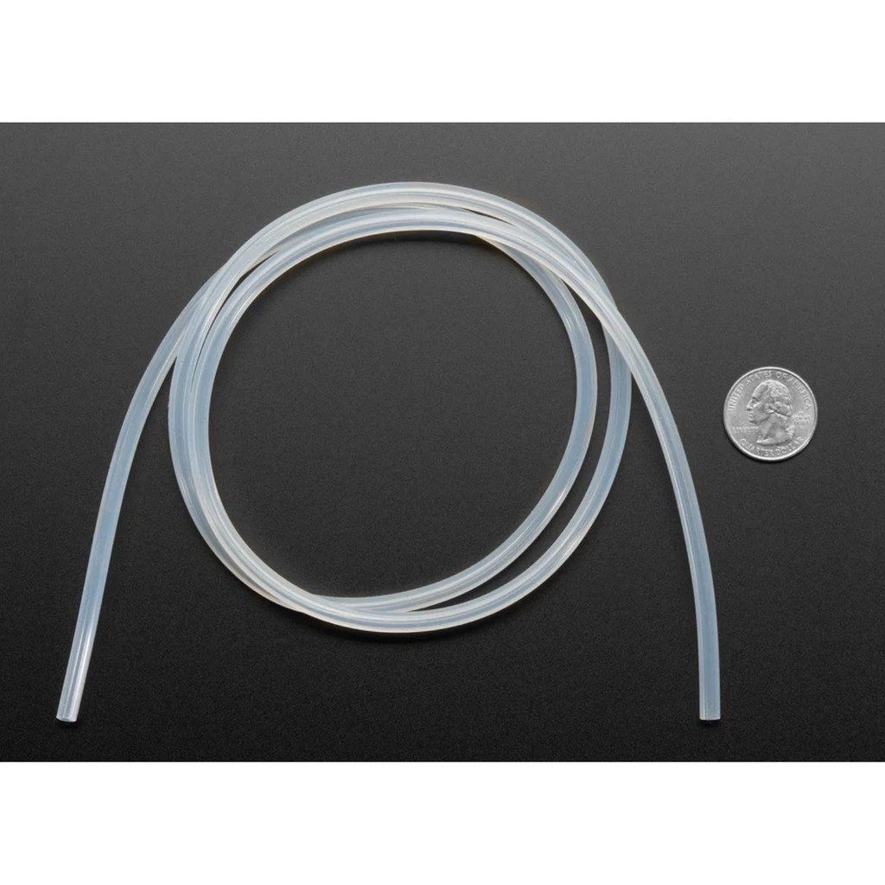 | Flexible, food-safe tubing. | Fitted to each peristaltic pump to carry water from the tank to the pot's drip outlet. | 4 | |
| Silicone Wire 22AWG | 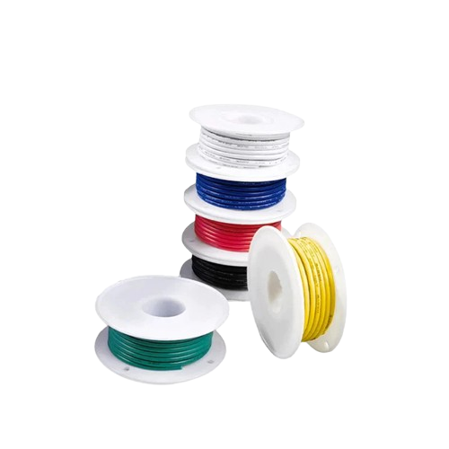 | Thin, highly flexible heat-resistant wire. | Low-current signal wiring: sensor connections and Arduino-to-relay control lines. | 1 | |
| Silicone Wire 20AWG | 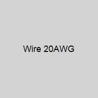 | Slightly thicker, flexible heat-resistant wire. | Power wiring: battery, buck converter, relay module, and pump connections. | 1 | |
| Waterproof ABS Enclosure |  | Sealed plastic housing that protects electronics from water and dust. | Houses the Arduino, protoboard, relay module, and power electronics, protecting them from rain and moisture outdoors. | 1 | |
| Soldering Wire | 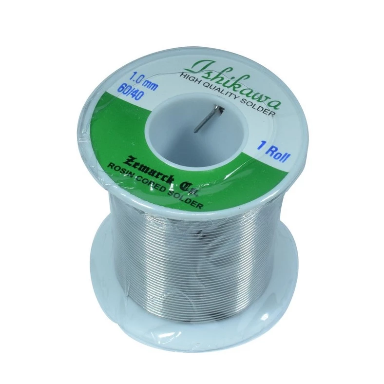 | Tin alloy solder used to join electrical connections. | Used to solder the pinheaders and wire connections on the protoboard. | 1 | |
| Soldering Iron | 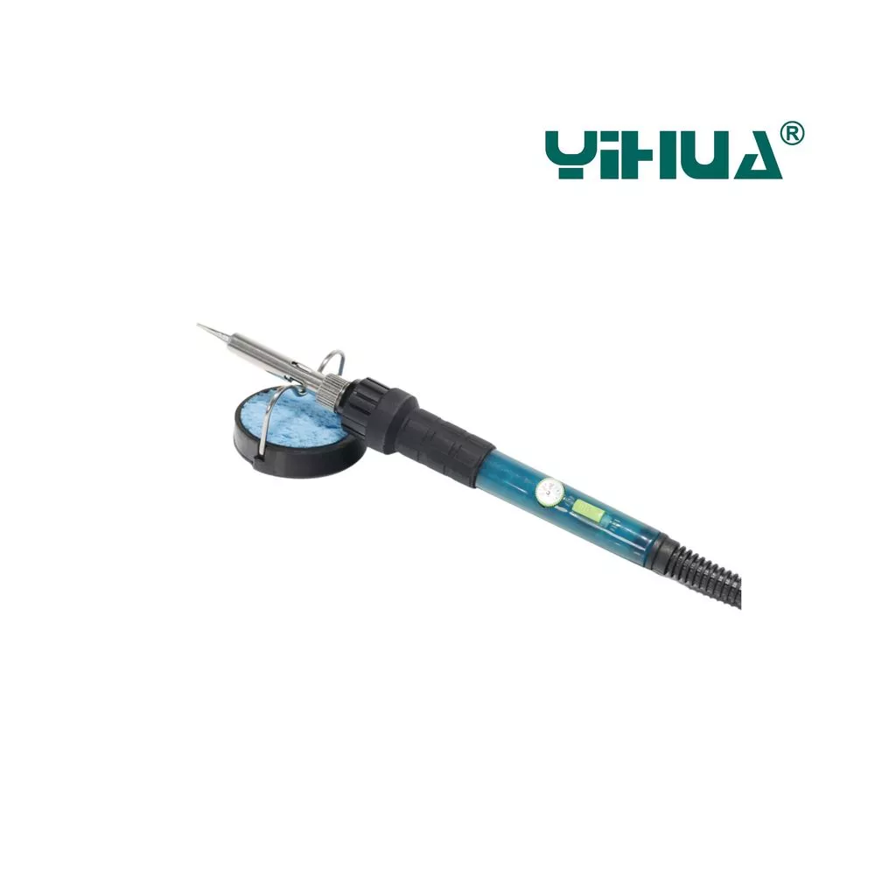 | Heated tool for melting solder. | Used during assembly to solder the circuit on the protoboard and the wire joints. | 1 | |

## Description

Rain Root rainwater harvesting system with moisture based drip irrigation system. The system is designed to collect rainwater and store it in a tank, which can then be used to irrigate plants based on their moisture needs. The system uses an Arduino Mega to control the irrigation process, with soil moisture sensors to monitor the moisture levels of the soil. When the soil moisture drops below a certain threshold, the system activates peristaltic pumps to deliver water to the plants.

Each pot has its own moisture sensor and pump, allowing for precise watering based on the needs of each individual plant. The system is powered by a solar panel and a LiPo battery, making it energy-efficient and environmentally friendly.

## Flowchart

### Control Logic

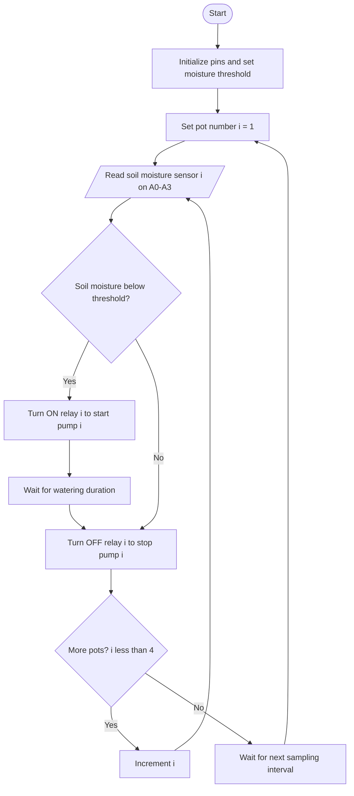

### Energy and Water Flow

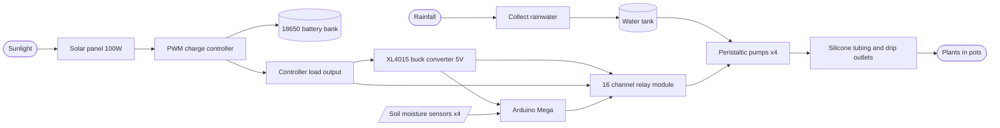

## Circuit Diagram

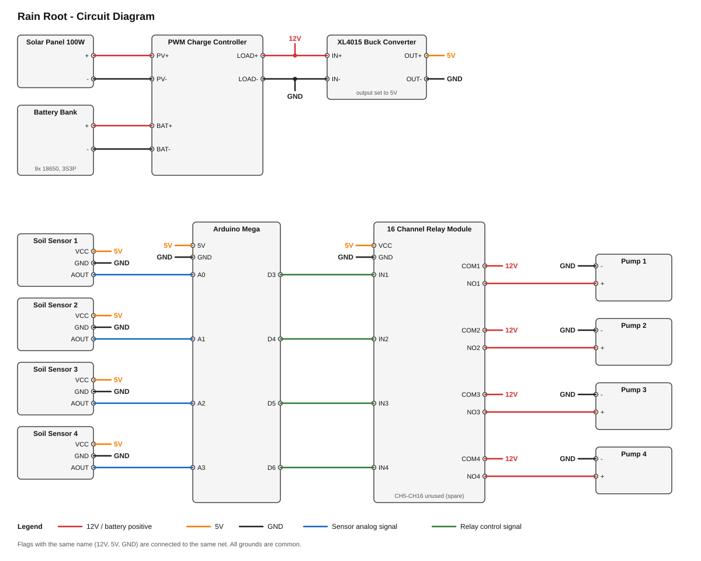

### Pin Connections

| From | Terminal / Pin | To | Terminal / Pin |
| ---- | -------------- | -- | -------------- |
| Solar Panel | + / - | PWM Charge Controller | PV+ / PV- |
| Battery Bank | + / - | PWM Charge Controller | BAT+ / BAT- |
| PWM Charge Controller | LOAD+ / LOAD- | XL4015 Buck Converter | IN+ / IN- |
| XL4015 Buck Converter (5V) | OUT+ | Arduino Mega | 5V |
| XL4015 Buck Converter | OUT- | Arduino Mega | GND |
| XL4015 Buck Converter (5V) | OUT+ / OUT- | Relay Module | VCC / GND |
| Arduino Mega | 5V / GND | Soil Moisture Sensors 1-4 | VCC / GND |
| Soil Moisture Sensor 1 | AOUT | Arduino Mega | A0 |
| Soil Moisture Sensor 2 | AOUT | Arduino Mega | A1 |
| Soil Moisture Sensor 3 | AOUT | Arduino Mega | A2 |
| Soil Moisture Sensor 4 | AOUT | Arduino Mega | A3 |
| Arduino Mega | D3 | Relay Module | IN1 |
| Arduino Mega | D4 | Relay Module | IN2 |
| Arduino Mega | D5 | Relay Module | IN3 |
| Arduino Mega | D6 | Relay Module | IN4 |
| PWM Charge Controller | LOAD+ | Relay Module | COM1 to COM4 |
| Relay Module | NO1 / NO2 / NO3 / NO4 | Pump 1 / 2 / 3 / 4 | + |
| Pump 1 / 2 / 3 / 4 | - | PWM Charge Controller | LOAD- |

Notes:

- The 9 cells are assumed to be wired 3S3P (about 11.1V), and the pumps are assumed to be 12V. Adjust if your pack or pumps differ.
- Set the XL4015 output to 5V with a multimeter before connecting the Arduino and relay module.
- Many relay modules are active LOW, so the relay turns on when its input pin is driven LOW.
- All grounds (battery, buck converter, Arduino, relay module, sensors) must be common.
