# Rain Root

## Description

Rain Root is a rainwater harvesting system with moisture-based drip irrigation. It collects rainwater in a tank for irrigating plants based on their moisture needs. An Arduino Mega reads the soil moisture sensors and activates peristaltic pumps when the soil moisture drops below a set threshold.

Each pot has its own moisture sensor and pump, allowing for precise watering based on the needs of each individual plant. The system is powered by a solar panel and a 3S3P 18650 Li-ion battery pack.

## Bill of Materials

| Item | Image | Description | Project Usage | Quantity | Product Link |
| ------ | ------- | ------------- | --------------- | ---------- | -------------- |
| Arduino Mega |  | Microcontroller board with many analog and digital I/O pins. | Main controller of the system. Reads the soil moisture sensors and switches the pumps through the relay module when moisture falls below the threshold. | 1 | [Buy here](https://s.shopee.ph/BUyGO9Zsj) |
| Protoboard 20x30cm |  | Large perforated prototyping board for soldered circuits. | Base for the permanent circuit: mounts the pinheaders and connects the Arduino, sensor lines, relay module, and power distribution. | 1 | [Buy here](https://s.shopee.ph/30p9dglv0M) |
| Male Pinheaders |  | Single-row male connector strips. | Soldered on the protoboard to provide plug-in connection points for the Arduino and sensor/relay wiring. | 10 | [Buy here](https://s.shopee.ph/9fM3aDSnnm) |
| Female Pinheaders |  | Single-row female socket strips. | Soldered on the protoboard as sockets so the Arduino and modules can be plugged in and removed without soldering. | 10 | [Buy here](https://s.shopee.ph/9fM3aDSnnm) |
| Analog Capacitive Soil Moisture Sensor |  | Corrosion-resistant sensor that outputs an analog voltage proportional to soil moisture. | One sensor per pot, wired to the Arduino analog inputs to measure each plant's soil moisture. | 4 | [Buy here](https://s.shopee.ph/AKbkNXKoe8) |
| 16 Channel Relay Module |  | Board of 16 relays that switch high-current loads from low-power logic signals. | Controlled by the Arduino to turn each peristaltic pump on and off; spare channels are available for expansion. | 1 | [Buy here](https://s.shopee.ph/4VdxQsOQWw) |
| 18650 Battery Cells |  | Rechargeable 18650 Li-ion cells for energy storage. | Battery bank (9 cells, 3S3P) that stores solar energy and powers the Arduino, relay module, and pumps, including when there is no sunlight. | 9 | [Buy here](https://s.shopee.ph/8VA6CHpZXr) |
| 3S 20A BMS | 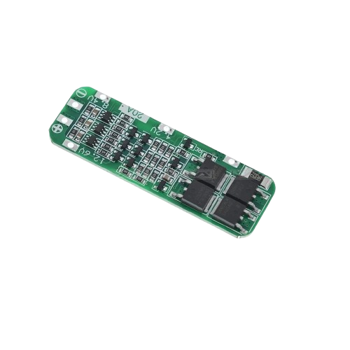 | Battery management system for 3-series Li-ion packs with cell balancing and overcharge, over-discharge, and short-circuit protection. | Connected between the 18650 cells and the charge controller to balance the 3 series groups and protect the pack. | 1 | [Buy here](https://s.shopee.ph/3g4qRRxtNY) |
| Solar Panel 100W (980mm x 530mm x 30mm) |  | Photovoltaic panel that converts sunlight into electricity. | Primary power source; charges the battery bank through the charge controller. | 1 | [Buy here](https://s.shopee.ph/1BNVSxuGnu) |
| Galvanized Iron Tubular Steel (20mm x 20mm) | 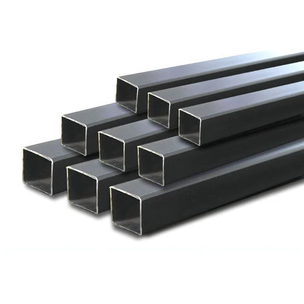 | Square tubular steel for the support frame. | Used to construct the Rain Root frame. | As required | |
| Orange Sanitary PVC Pipe (3" 3 meters) |  | Orange 3-inch sanitary PVC pipe. | Forms the gutter that collects rainwater from the solar panel and directs it toward the tank. | 1 | |
| 90-degree PVC Elbow (3-inch) | 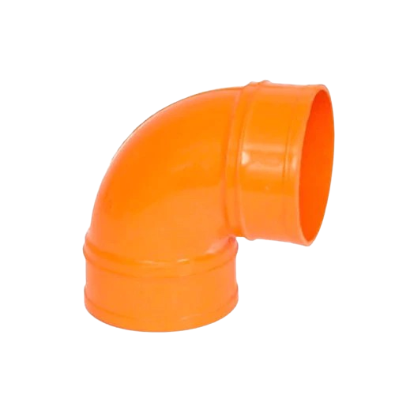 | 90-degree elbow fitting for 3-inch PVC pipe. | Directs rainwater from the gutter toward the tank. | 3 | |
| PVC End Cap (3-inch) | 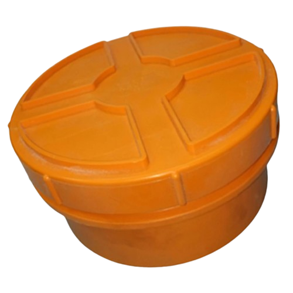 | End cap for 3-inch PVC pipe. | Closes the end of the rainwater gutter. | 1 | |
| PWM Solar Charge Controller |  | Regulates solar panel output to charge a battery safely using PWM. | Placed between the solar panel and battery bank to prevent overcharging and protect the batteries. | 1 | [Buy here](https://s.shopee.ph/1BNVT2gUjz) |
| XL4015 Buck Converter |  | Adjustable DC-DC step-down converter (up to 5A). | Steps the battery voltage down to regulated 5V for the Arduino, sensors, and relay-module logic. The pumps receive battery power through the relay contacts. | 1 | [Buy here](https://s.shopee.ph/7AeicFrMbw) |
| Peristaltic Pump |  | Pump that moves liquid by compressing a flexible tube; self-priming and accurate. | One pump per pot, switched by the relay module to deliver measured water from the tank to the plant. | 4 | [Buy here](https://s.shopee.ph/4VdxRtbxPP) |
| Silicone Tubing |  | Flexible, food-safe tubing. | Fitted to each peristaltic pump to carry water from the tank to the pot's drip outlet. | 4 | |
| Water Tank (50L 570mm x 300mm x 300mm) | 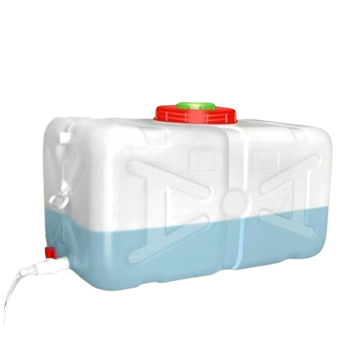 | Water storage tank for the irrigation system. | Stores rainwater collected for watering the plants. | 1 | [Buy here](https://s.shopee.ph/5q9L7JRwen) |
| Silicone Wire 22AWG |  | Thin, highly flexible heat-resistant wire. | Low-current signal wiring: sensor connections and Arduino-to-relay control lines. | 1 | [Buy here](https://s.shopee.ph/6AmBQVoPqb) |
| Silicone Wire 20AWG |  | Slightly thicker, flexible heat-resistant wire. | Power wiring: battery, buck converter, relay module, and pump connections. | 1 | [Buy here](https://s.shopee.ph/6AmBQVoPqb) |
| Waterproof ABS Enclosure (240mm x 160mm x 92mm) |  | Sealed plastic housing that protects electronics from water and dust. | Two enclosures are mounted beneath the solar panel: one houses the electronics and battery, and the other houses the water pumps. | 2 | [Buy here](https://s.shopee.ph/LoOU0t4h9) |
| Soldering Wire |  | Tin alloy solder used to join electrical connections. | Used to solder the pinheaders and wire connections on the protoboard. | 1 | [Buy here](https://s.shopee.ph/9fM3bE0flr) |
| Soldering Iron |  | Heated tool for melting solder. | Used during assembly to solder the circuit on the protoboard and the wire joints. | 1 | [Buy here](https://s.shopee.ph/9KjDCjx3mV) |

## 3D Model

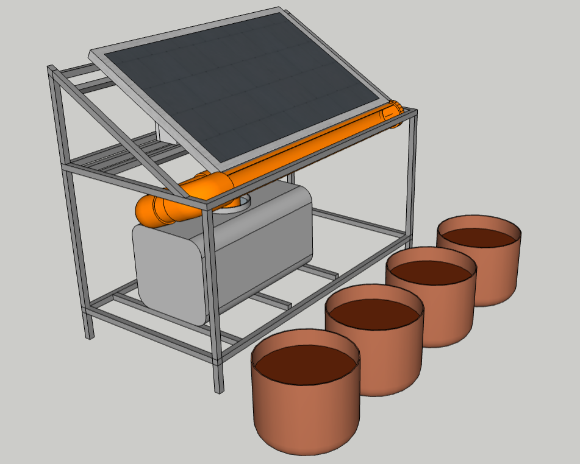

The 100W solar panel is mounted at a 30-degree incline and also serves as the rainwater collector. Its dimensions are 980mm x 530mm x 30mm, as listed in the Bill of Materials. Rainwater runs into an orange 3-inch sanitary PVC pipe gutter and is directed to the tank using three 90-degree elbows; one end cap closes the gutter.

The frame is made from 20mm x 20mm galvanized iron tubular steel. Two waterproof enclosures sit beneath the solar panel and are accessible from the back of the frame. One enclosure houses the electronics and battery, and the other houses the water pumps. The peristaltic pumps draw water from the tank and deliver it to the pots through silicone hose.

### Model Views

| East | North | South |
| --- | --- | --- |
| 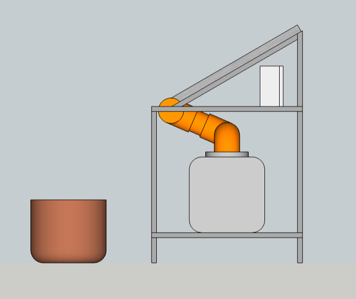 | 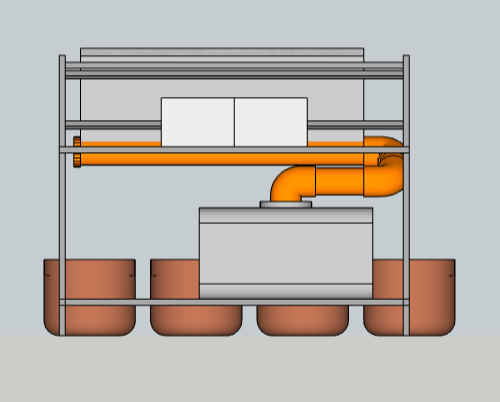 | 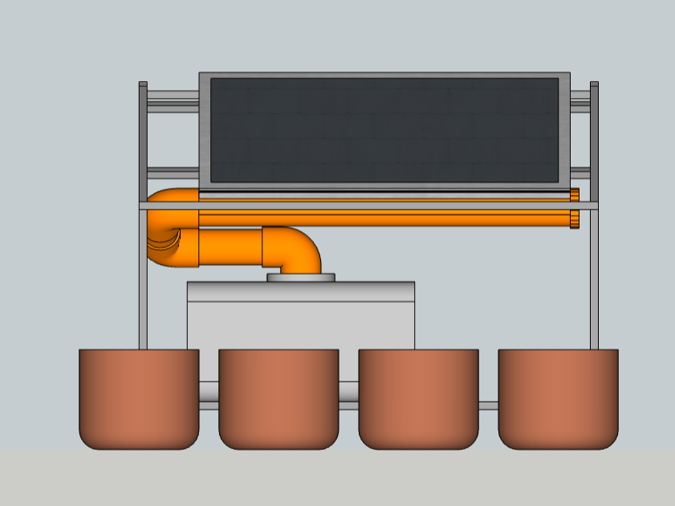 |

| Top | West |
| --- | --- |
| 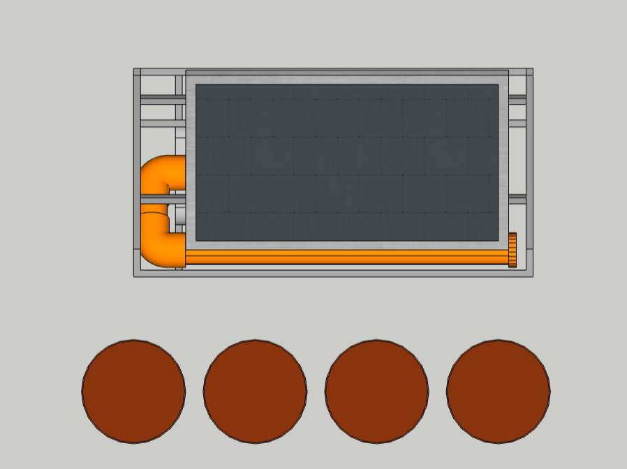 | 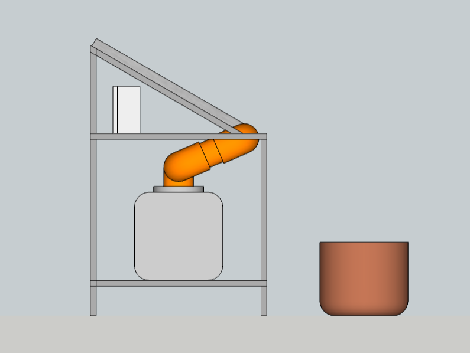 |

## Flowchart

### Control Logic

### Energy and Water Flow

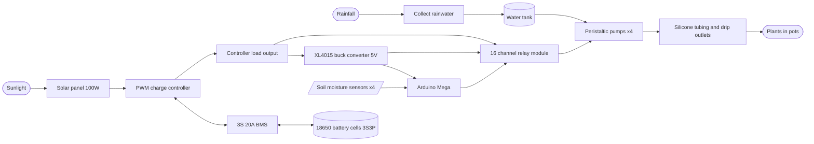

## Circuit Diagram

### Pin Connections

| From | Terminal / Pin | To | Terminal / Pin |
| ---- | -------------- | -- | -------------- |
| Solar Panel | + / - | PWM Charge Controller | PV+ / PV- |
| Battery Cells (3S3P) | + / 2 / 1 / - | BMS | B+ / B2 / B1 / B- |
| BMS | P+ / P- | PWM Charge Controller | BAT+ / BAT- |
| PWM Charge Controller | LOAD+ / LOAD- | XL4015 Buck Converter | IN+ / IN- |
| XL4015 Buck Converter (5V) | OUT+ | Arduino Mega | 5V |
| XL4015 Buck Converter | OUT- | Arduino Mega | GND |
| XL4015 Buck Converter (5V) | OUT+ / OUT- | Relay Module | VCC / GND |
| Arduino Mega | 5V / GND | Soil Moisture Sensors 1-4 | VCC / GND |
| Soil Moisture Sensor 1 | AOUT | Arduino Mega | A0 |
| Soil Moisture Sensor 2 | AOUT | Arduino Mega | A1 |
| Soil Moisture Sensor 3 | AOUT | Arduino Mega | A2 |
| Soil Moisture Sensor 4 | AOUT | Arduino Mega | A3 |
| Arduino Mega | D3 | Relay Module | IN1 |
| Arduino Mega | D4 | Relay Module | IN2 |
| Arduino Mega | D5 | Relay Module | IN3 |
| Arduino Mega | D6 | Relay Module | IN4 |
| PWM Charge Controller | LOAD+ | Relay Module | COM1 to COM4 |
| Relay Module | NO1 / NO2 / NO3 / NO4 | Pump 1 / 2 / 3 / 4 | + |
| Pump 1 / 2 / 3 / 4 | - | PWM Charge Controller | LOAD- |

Notes:

- The 9 cells are assumed to be wired 3S3P (about 11.1V), and the pumps are assumed to be 12V. Adjust if your pack or pumps differ.
- The BMS must be a 3S type. Connect the cell balance leads (B-, B1, B2, B+) in order and verify cell voltages before connecting the BMS output; the charge controller connects only to the BMS P+ / P- output.
- Set the XL4015 output to 5V with a multimeter before connecting the Arduino and relay module.
- Many relay modules are active LOW, so the relay turns on when its input pin is driven LOW.
- All grounds (battery, buck converter, Arduino, relay module, sensors) must be common.

## Q&A

### Why use an Arduino Mega?

The Arduino Mega provides up to 16 analog inputs for the soil-moisture sensors.

### Why use a 16-channel relay module?

It provides one relay channel for each of up to 16 peristaltic pumps.

### Why use a 3S battery pack for 12V pumps?

A 3S battery pack provides a voltage suited to the 12V pumps.

### Why use a PWM solar charge controller instead of MPPT?

The PWM solar charge controller is less efficient than MPPT, but costs less and suits this low-power application.

### Why use one sensor and one pump per pot?

Each pot has its own sensor and pump so it can be monitored and watered individually.

### Why use silicone-insulated wire?

Silicone wire is flexible and beginner-friendly to solder.

### Why use a relay module?

The relay module lets the Arduino switch the pumps on and off.

### Why use an XL4015 buck converter?

The XL4015 steps the battery voltage down to 5V for the Arduino and control circuit.

### How do I set up the XL4015?

Apply input power, adjust the trim pots, and observe the display until it reads 5V and 5A.
